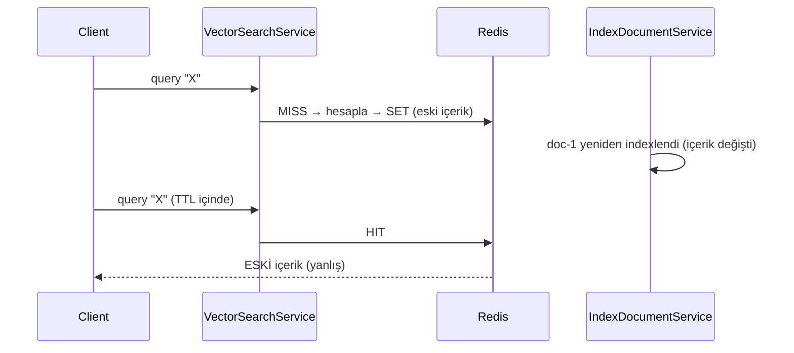

# Bölüm 8 — Redis ve Caching

**Durum:** ✅ Implemented (embedding cache, query cache, index-version-aware key — Faz 2 ile doğrulandı) · 🔵 Planned (strategy/reranker/transformer alanlarının fingerprint'e eklenmesi — Faz 4–6)
**Ana dosyalar:** `src/Rag.Core/Providers/Embeddings/CachingEmbeddingProvider.cs`, `src/Rag.Core/Services/QueryCacheKeyBuilder.cs`, `src/Rag.Core/Services/VectorSearchService.cs`, `src/Rag.Core/Options/{EmbeddingCacheOptions,QueryCacheOptions}.cs`
**Testler:** `tests/Rag.Core.Tests/Services/QueryCacheCorrectnessTests.cs`, `QueryCacheKeyBuilderTests.cs`, `Providers/Embeddings/CachingEmbeddingProviderTests.cs`

## 8.1 Nedir?

Cache, pahalı bir hesabın sonucunu daha ucuz bir yerde saklayıp aynı girdi tekrar geldiğinde yeniden hesaplamamaktır. Bu repoda **iki ayrı cache** vardır ve ikisi çok farklı risk taşır:

| Cache | Girdi → Çıktı | Neden güvenli/riskli |
|---|---|---|
| **Embedding cache** | metin → `float[]` | **Saf fonksiyon**: aynı model + aynı metin her zaman aynı vektör. Invalidation gerektirmez. |
| **Query-result cache** | (sorgu, filtre, topK, …) → chunk listesi | **Duruma bağlı**: sonuç, index'in o anki içeriğine bağlıdır. Yanlış anahtar = yanlış (stale) cevap. |

Bu ayrım bölümün en önemli fikridir: *bir cache'in doğruluğu, anahtarın çıktıyı etkileyen her şeyi kapsamasına bağlıdır.*

## 8.2 Hangi problemi çözer?

- Embedding API çağrısı yavaş (yüzlerce ms) ve ücretli. Aynı chunk/sorgu tekrar embed edilirse boşa maliyet. `CachingEmbeddingProvider` decorator'ı bunu `IEmbeddingProvider` arkasında şeffafça çözer.
- Sık tekrarlanan sorgular için tüm pipeline'ı (embed + vektör arama) atlamak. Kapalı gelir (`QueryCache:Enabled=false`) çünkü doğruluk riski vardır.

## 8.3 İçeride nasıl çalışır?

### Embedding cache (`CachingEmbeddingProvider`)

Decorator pattern: `AddEmbeddingProvider` (`ServiceCollectionExtensions.cs`) cache açıksa gerçek provider'ı `CachingEmbeddingProvider` ile sarar.

```
key = "rag:emb:{EmbeddingModel}[:{dimensions}]:{SHA256(text) hex}"
value = float[] → ham byte (MemoryMarshal.AsBytes; 4 byte/float, base64/JSON yok)
TTL = EmbeddingCache:TtlHours (24)
```

- `EmbedBatchAsync`: önce her metin için GET; **sadece miss'leri** tek batch olarak inner provider'a gönderir; sonuçları orijinal sıraya yerleştirir; yazmaları `Task.WhenAll` ile paralel yapar.
- Ham byte serileştirme: 1536 boyutlu vektör = 6144 byte. JSON'a göre ~3–4× küçük ve parse maliyeti yok.
- Anahtardaki SHA-256: uzun metni sabit uzunluğa indirger; Redis anahtarında metin sızdırmaz (gizlilik avantajı); çakışma olasılığı ihmal edilebilir.

### Query-result cache (`VectorSearchService` + `QueryCacheKeyBuilder`)

Değer: `List<RetrievedChunkDto>` JSON (Web defaults). TTL: `QueryCache:TtlMinutes` (5).

**Anahtar (Faz 2 sonrası):** `RetrievalFingerprint` kaydındaki *her alan* anahtara girer:

| Alan | Neden anahtarda? |
|---|---|
| `Collection` | farklı koleksiyon, farklı içerik |
| **`IndexVersion`** | koleksiyonun içeriği değişti mi? (aşağıda) |
| `EmbeddingProvider`, `EmbeddingModel`, `VectorSize` | farklı vektör uzayı → farklı sonuç |
| `Strategy` (şu an `"dense"`) | ileride hybrid/rerank aynı sorguya farklı sonuç verir |
| `TopK` | sonuç listesi uzunluğu |
| `Filters` (key'e göre sıralı) | farklı filtre, farklı alt küme |
| `Query` | sorgu metni |

Kodlama **length-prefix**: her alan `"{uzunluk}:{değer};"` biçiminde eklenir. Eski format `a=1|b=2` gibi ayraçlı birleştirmeydi; `{"a":"1|b=2"}` ile `{"a":"1","b":"2"}` aynı ham string'i üretiyordu (**çakışma**). Length-prefix kodlaması *injective*'dir: hiçbir değer ayraç taklit edemez. Sonra SHA-256 → `rag:query:v2:{HEX}`.

`SchemaVersion` anahtarın ön ekinde durur: alan kümesi/kodlama değişirse sabiti artırırız, eski anahtarlar erişilemez olur ve TTL ile kendiliğinden ölür (flush gerekmez).

### Index versioning

`CollectionMetadata.IndexVersion` opak bir token'dır (`Guid.NewGuid().ToString("N")`). `IndexDocumentService`, her başarılı `Delete + Upsert` sonrasında yeni token'ı metadata'ya yazar. Query tarafı zaten her sorguda metadata okuduğu için **ek RPC maliyeti yoktur**; token anahtara girer. İçerik değişince token değişir → eski cache girdileri *erişilemez* olur. Bu **"anahtarı değiştirerek invalidation"** (key-based expiry / generational caching) tekniğidir: silme yok, dağıtık "sil" yarışı yok.

Neden artan sayaç değil GUID? Qdrant'ta atomik increment yok; iki eşzamanlı indexleyici aynı sayıyı okuyup aynı sayıyı yazabilirdi ve içerik değişse bile versiyon aynı kalabilirdi. GUID ile iki yazıcı farklı token üretir; son yazan kazanır, ama *hiçbir değişiklik token'ı aynı bırakmaz*.

**Geriye dönük uyumluluk:** Versiyonlama öncesi yazılmış koleksiyonlarda `IndexVersion` boş string okunur (Qdrant'ta payload alanı yok → `GetString` boş döner; Pg'de `ALTER TABLE … ADD COLUMN IF NOT EXISTS index_version text NOT NULL DEFAULT ''`). Boş token geçerli ve sabit bir versiyondur; ilk indexlemeden sonra gerçek token'a geçilir. Bu, `PgVectorMetadataTests.LegacyMetadataTable_…` ile gerçek Postgres'te doğrulandı.

## 8.4 Kodda nerede?

- Anahtar üretimi: `QueryCacheKeyBuilder.Build(RetrievalFingerprint)`.
- Token yazımı: `IndexDocumentService.IndexAsync` (upsert sonrası `SetCollectionMetadataAsync(expected with { IndexVersion = … })`).
- Token okuma: `VectorSearchService.SearchAsync` → `metadata.IndexVersion`.
- Persistans: `QdrantVectorStore` payload `indexVersion`; `PgVectorStore` `index_version` kolonu.

## 8.5 Başarısızlık senaryosu: faz 2 öncesi stale cache

Eski anahtar: `collection|topK|filters|query`. Zaman çizelgesi:



Üç regresyon testi bu hatayı **düzeltmeden önce** kırmızı gösterdi (commit `test: regression tests demonstrating stale query cache`):

| Test | Eski davranış | Şimdi |
|---|---|---|
| `Reindexing_a_document_invalidates_cached_query_results` | eski metin döndü | yeni metin |
| `Cache_entries_are_not_shared_between_embedding_models` | model B, model A sonucunu aldı | ayrı |
| `Filters_that_differ_only_by_delimiter_characters_do_not_collide` | iki filtre aynı girdi | ayrı |

## 8.6 Ne ters gidebilir? (hâlâ geçerli sınırlar)

| Risk | Açıklama |
|---|---|
| **Okuma–yazma yarışı** | Sorgu metadata'yı (v1) okur, tam o sırada indexleme v2'yi yazar; sorgu v1 anahtarıyla eski sonucu cache'ler. Sonuç yalnızca v1 anahtarına yazılır; v2 sorguları buna erişmez. Zararı, o anki tek yanıtın tazeliğiyle sınırlıdır — kalıcı stale üretmez. |
| **Çok-doküman indexleme** | Her doküman ayrı token üretir; bir toplu indexleme sırasında cache sürekli geçersizleşir (cache hit oranı düşer). Bu doğru davranıştır (içerik gerçekten değişiyor). |
| **Token yazımı başarısız olursa** | Upsert başarılı, metadata yazımı hata verirse içerik yeni, token eski kalır → stale pencere. Mesaj nack'lenir ve yeniden işlenir (idempotent) → token sonunda yazılır. Aradaki pencere TTL (5 dk) ile sınırlıdır. |
| **Embedding cache + model adı aynı, provider farklı** | Anahtarda provider yok (Assessment A10). Düşük olasılık; Faz 2 kapsamı dışında bırakıldı. |
| **Cache stampede** | Popüler anahtar düşünce çok istek aynı anda hesaplar. Mevcut tasarım korumasızdır; single-flight yok. |
| **Redis erişilemez** | `cache.GetAsync` exception → `SearchAsync` genel catch'ine düşer ve `Success=false` döner. **Cache arızası sorguyu düşürür**; "cache bypass on failure" henüz yok (bkz. egzersiz 3). |

## 8.7 Alternatifler

| Yaklaşım | Artı | Eksi |
|---|---|---|
| **Versiyonlu anahtar (seçilen)** | Silme yok, yarış yok, basit | Eski girdiler TTL'e kadar yer kaplar |
| Pattern ile silme (`SCAN` + `DEL`) | Bellek hemen boşalır | `SCAN` pahalı, atomik değil, çok-instance'ta yarış |
| Tag set'leri (koleksiyon başına anahtar listesi) | Hedefli silme | Ek durum, tutarlılık sorunu |
| Sadece kısa TTL | Hiç mantık gerekmez | Her zaman stale pencere |
| Hiç query cache yok | Her zaman doğru | Her sorgu embed + arama maliyeti |

## 8.8 Test ve gözlem

- 92 hızlı unit test (ağsız). `QueryCacheKeyBuilderTests`: determinizm, filtre sırasından bağımsızlık, **her alanın tek tek anahtarı değiştirdiği** (`Theory`, 10 varyant), ayraç taklidi, şema öneki.
- Gözlem: span tag'i `rag.cache_hit`; `rag.queries.executed` sayacı artık cache hit'te de artar (`cache_hit=true` etiketiyle) — önceden eksik sayılıyordu (Assessment A2).
- ⚠️ Henüz yok: cache hit/miss oranı için ayrı metrik (Faz 9 adayı).

## 8.9 Mülakatta nasıl anlatırım?

> "Cache'in doğruluğu anahtarın kapsamına bağlıdır. Embedding cache saf fonksiyon olduğu için model + metin hash'i yeterli. Sonuç cache'i ise index içeriğine bağlı olduğundan koleksiyon başına bir `IndexVersion` token'ı tutuyorum; her indexlemede yeniden üretiliyor ve sorgu anahtarına giriyor. Böylece invalidation 'silme' değil 'anahtar değiştirme' oluyor: dağıtık silme yarışı yok, eski girdiler TTL ile ölüyor. Token için sayaç yerine GUID seçtim çünkü Qdrant'ta atomik increment yok. Anahtarı length-prefix ile kodladım, çünkü ayraçlı birleştirme farklı filtrelerin çakışmasına izin veriyordu — bunu önce kırmızı testle kanıtladım, sonra düzelttim."

## Alıştırmalar

1. `IndexVersion` yerine koleksiyonun chunk sayısını kullansaydık hangi senaryoda stale kalırdı? (Aynı sayıda chunk, farklı içerik.)
2. Hybrid retrieval'da `Strategy="hybrid"` ve RRF `k` değeri anahtara girmezse hangi hata oluşur? Bunu kırmızı gösteren bir test yaz.
3. Redis çökerse sorgunun yine de cevap vermesi için `VectorSearchService`'te cache çağrılarını nasıl izole edersin? resilience katmanının hangi strateji (circuit breaker + fallback) uygun? (Bölüm 10)
4. Cache stampede'i engellemek için single-flight (aynı anahtara tek hesaplama) tasarla; çok-instance'ta neden yetersiz kalır?
