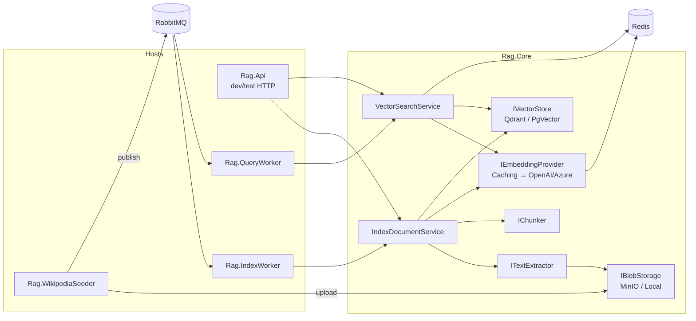

# Bölüm 1 — Sistem Mimarisi

**Durum:** ✅ Implemented (mevcut sistem) · 🔵 Planned (retrieval pipeline genişletmeleri — bkz. §1.9)
**Kaynak commit:** `abd338e`

## 1.1 Nedir?

RagService, doküman yükleme (ingestion) ve anlamsal arama (semantic retrieval) yapan, mesaj tabanlı (message-driven) bir .NET 10 backend'idir. "RAG"in **R** kısmını — Retrieval — uygular. "Generation" (LLM cevap üretimi) bu repoda **yoktur**; servis, ilgili chunk'ları döndürür ve cevabı üretmek çağıran tarafın işidir.

## 1.2 Hangi problemi çözer?

Bir LLM'in özel doküman koleksiyonu hakkında doğru cevap verebilmesi için önce ilgili parçaların bulunması gerekir. Bu, iki ayrı iş yükü demektir:

| İş yükü | Özellik | Bu yüzden |
|---|---|---|
| **Index** (yazma) | Yavaş, I/O ağır (embedding API), toplu, hata toleranslı olmalı | Kuyruk + worker |
| **Query** (okuma) | Düşük gecikme, çok sayıda, idempotent | Ayrı worker, cache |

İkisini aynı process'te senkron yapmak, yavaş embedding çağrılarının sorguları bloke etmesine ve bir indexleme patlamasının sorgu servisini düşürmesine yol açar. Ayrı kuyruklar bu iki yükü izole eder.

## 1.3 Bileşen haritası

**Dependency flow (bağımlılık yönü):** Host'lar → `Rag.Core` servisleri → soyutlamalar (`Abstractions/`) ← provider'lar (`Providers/`). Servisler yalnızca interface'leri bilir; hangi implementasyonun kullanılacağı `ServiceCollectionExtensions` içinde `Rag:*Provider` ayarına göre seçilir (`src/Rag.Core/Extensions/ServiceCollectionExtensions.cs`). Bu, Dependency Inversion Principle'ın doğrudan uygulamasıdır.

## 1.4 Index pipeline (gerçek kod)

`IndexDocumentService.IndexAsync` (`src/Rag.Core/Services/IndexDocumentService.cs`) sırası:

1. `ValidateRequest` — RequestId, Collection, DocumentId, FilePath zorunlu.
2. `textExtractor.ExtractAsync` — uzantıya göre PDF/DOCX/düz metin.
3. `chunker.ChunkAsync` — token tabanlı; `ChunkId = "{documentId}:{index:D6}"`.
4. `embeddingProvider.EmbedBatchAsync` — Redis cache'li; adet ve boyut doğrulanır.
5. **Collection compatibility guard** — mevcut koleksiyonun provider/model/boyutu ile config uyuşmuyorsa reddet.
6. `EnsureCollectionAsync`, ilk indexlemede `SetCollectionMetadataAsync`.
7. `DeleteByDocumentIdAsync` **sonra** `UpsertAsync` — doküman küçüldüyse eski chunk'lar artık kalmaz.

> ⚠️ **Dikkat — atomiklik yok.** 7. adımda delete ile upsert arasında bir çökme olursa doküman geçici olarak koleksiyondan kaybolur. Mesaj nack'lenip yeniden işlendiğinde düzelir (idempotent), ama bu aralıkta sorgular o dokümanı bulamaz. Bu bilinen bir trade-off'tur; çözüm adayları: önce upsert, sonra "eski sürüm chunk'larını sil" (document version alanı ile).

## 1.5 Query pipeline (gerçek kod)

`VectorSearchService.SearchAsync` (`src/Rag.Core/Services/VectorSearchService.cs`):

1. Validate → `topK` (istek yoksa `Rag:DefaultTopK`).
2. `GetCollectionMetadataAsync` — yoksa "has not been indexed" hatası; uyumsuzsa hata.
3. Query cache (opsiyonel, **varsayılan kapalı**): hit ise erken dön.
4. `EmbedAsync(query)` → boyut doğrula.
5. `vectorStore.SearchAsync(collection, embedding, topK, filters)`.
6. Sonucu `RetrievedChunkDto` listesine map'le, cache'e yaz, `rag.queries.executed` metriğini artır.

Hata modeli: servis **exception fırlatmak yerine** `QueryResponse { Success=false, ErrorMessage }` döner; yalnızca `OperationCanceledException` yeniden fırlatılır (böylece worker kapanışı doğru çalışır). `BrokenCircuitException` istisnası worker'da özel ele alınır (§1.6).

## 1.6 Worker tabanlı işleme

İki worker aynı kalıbı izler (`src/Rag.QueryWorker/Worker.cs`, `src/Rag.IndexWorker/Worker.cs`):

- `BackgroundService.ExecuteAsync`: bağlan (retry'lı) → `rag.dlx` exchange + `{queue}.dlq` tanımla → `BasicQosAsync(prefetch)` → `AsyncEventingBasicConsumer`.
- `autoAck: false`. Sonuç → ack/nack matrisi:

| `HandleMessageAsync` sonucu | Aksiyon | Anlamı |
|---|---|---|
| `true` | `BasicAck` | Başarılı |
| `false` | `BasicNack(requeue:false)` → DLQ | Kalıcı hata (poison message) |
| `null` | `BasicNack(requeue:true)` | Geçici: circuit breaker açık, downstream yok |

- Eşzamanlılık: `SemaphoreSlim(Concurrency)` ile sınırlı; prefetch broker tarafında yayımlanmamış mesaj sayısını sınırlar. İkisi birlikte **backpressure** sağlar (Bölüm 3).
- Query cevabı `ReplyTo` kuyruğuna `CorrelationId` ile döner (RPC-over-AMQP kalıbı).

## 1.7 Message-driven mimari: neden?

| Seçenek | Artı | Eksi |
|---|---|---|
| **RabbitMQ (mevcut)** | Yük izolasyonu, retry/DLQ, yatay ölçek, backpressure | Operasyonel karmaşıklık, at-least-once → idempotency şart, ek gecikme |
| Senkron HTTP | Basit, düşük gecikme | Yavaş embedding çağrısı çağırana bağlanır, hata yayılımı |

Index tarafı için kuyruk kesinlikle yerindedir. **Query tarafı için tartışmalıdır**: RPC-over-AMQP ekstra bir hop ekler; bu repoda gerekçe, API Gateway'in dışarıda olması ve worker'ların bağımsız ölçeklenmesidir. `Rag.Api` aynı servisleri doğrudan çağırarak senkron yolun da var olduğunu gösterir (yalnızca dev/test amaçlı).

## 1.8 Ne ters gidebilir?

| Senaryo | Sonuç | Nerede ele alınıyor |
|---|---|---|
| OpenAI down | Polly retry → breaker açılır → `BrokenCircuitException` → mesaj requeue | `RagPipelines.ExternalApi` |
| Bozuk doküman | `Success=false` → DLQ | worker nack(requeue:false) |
| Embedding modeli config'te değişti | Collection guard hata verir (sessiz bozulma yok) | `IsCompatible` |
| Reindex sonrası eski sorgu cache'i | **Stale sonuç** (düzeltilecek, Faz 2) | Bölüm 8 |
| Index çökmesi delete/upsert arası | Geçici kayıp doküman | §1.4 uyarı |

## 1.9 Mevcut vs planlanan

| Konu | Durum |
|---|---|
| Dense retrieval, filtre, cache, worker'lar, DLQ, Polly, OTel | ✅ Implemented |
| Index version / cache doğruluğu | 🔵 Planned (Faz 2) |
| Evaluation, hybrid, RRF, reranking, query rewriting | 🔵 Planned (Faz 3–6) |
| `Rag.DefinitionSeeder` (`plan.md`) | 🔵 Planned, solution'da yok |
| Auth/AuthZ | ❌ Yok (Bölüm 13) |

## 1.10 Test ve gözlem

- Unit: `tests/Rag.Core.Tests/Services/*` (72 test, ağ gerektirmez).
- Integration: `tests/Rag.IntegrationTests/EndToEndTests.cs` (Testcontainers ile gerçek altyapı).
- Gözlem: span `rag.query` / `rag.index` (tag: collection, result_count, cache_hit), metrikler `rag.queries.executed`, `rag.query.errors`, `rag.documents.indexed`, `rag.embedding.duration` (`src/Rag.Core/Telemetry/RagTelemetry.cs`).

## 1.11 Mülakatta nasıl anlatırım?

> "Sistem iki bağımsız yoldan oluşuyor: yazma yolu RabbitMQ üzerinden çalışan IndexWorker; okuma yolu QueryWorker. İndex yolu yavaş ve dış API'ye bağımlı olduğu için kuyrukta çalışıyor; manual ack, DLQ ve breaker-aware requeue ile at-least-once teslimat sağlıyoruz, chunk ID'leri deterministik olduğu için yeniden işleme idempotent. Query tarafında ise kritik koruma, koleksiyon metadata'sı ile embedding konfigürasyonunun karşılaştırılması — model değişirse sessizce kötü sonuç vermek yerine açıkça hata veriyoruz. Bilinen zayıflığım: delete-then-upsert atomik değil ve query cache'i index versiyonundan bağımsızdı; ikincisini versiyonlu cache key ile düzelttim."

(Son cümle Faz 2 tamamlanınca doğru olacaktır; o zamana kadar bu bölüm güncellenecek.)

## Alıştırmalar

1. `HandleMessageAsync` içinde `BrokenCircuitException` yakalanmasaydı hangi ack/nack çalışırdı? Mesaj nereye giderdi?
2. Delete-then-upsert yerine "versioned upsert + old-version cleanup" tasarla; hangi ek alan ve hangi failure mode'lar doğar?
3. Query path'ine ikinci bir embedding sağlayıcısı eklenirse hangi yerler değişmeli? (İpucu: `AddEmbeddingProvider`, `IsCompatible`.)
