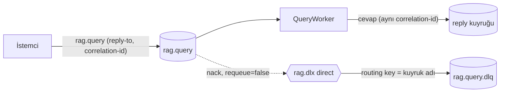

# Bölüm 3 — RabbitMQ ve Dağıtık Mesajlaşma

**Durum:** ✅ Implemented · 🟡 Partial (kuyruk derinliği/DLQ için **uyarı ve yeniden oynatma aracı yok**; aşağıda "Ne ters gidebilir")
**Ana dosyalar:** `src/Rag.IndexWorker/Worker.cs`, `src/Rag.QueryWorker/Worker.cs`, `src/Rag.Core/Options/RabbitMqOptions.cs`
**Doğrulama:** `scripts/e2e.py` (gerçek RabbitMQ; `docs/release/e2e-report.md`, bölüm 3, 7, 12)

## 3.1 Nedir?

RabbitMQ, producer ile consumer'ı ayıran bir **mesaj aracısıdır (broker)**. Burada iki iş kuyruğu vardır: `rag.index` (doküman indexleme) ve `rag.query` (arama). İstemci mesajı kuyruğa yazar; bir worker alır, işler, cevabı mesajdaki `reply-to` kuyruğuna yazar. Bu, **request/reply over messaging** desenidir.

## 3.2 Hangi problemi çözer?

- **Yük izolasyonu:** yavaş, ücretli embedding işi (index) sorgu gecikmesini bozmaz (Bölüm 1).
- **Geri basınç (backpressure):** kuyruk büyür, süreç çökmez; `prefetch` ve `Concurrency` işçinin kaldırabileceği kadar iş alır.
- **Dayanıklılık:** worker çökerse ack'lenmemiş mesaj broker'a döner (yeniden teslim).

## 3.3 İçeride nasıl çalışır?

### Topoloji

Worker açılışta (`SetupQueuesAsync`): `rag.dlx` (direct, durable) exchange'ini, `{kuyruk}.dlq` kuyruğunu ve onun `routing key = kuyruk adı` bağını bildirir; ana kuyruğu `x-dead-letter-exchange=rag.dlx` argümanıyla `durable` açar. Kuyruk daha önce argümansız oluşturulmuşsa uyarı loglanır ve argümansız yeniden bildirilir (**DLQ o durumda devre dışıdır** — kuyruğu silip yeniden başlatmak gerekir).

### Mesaj sonucu → broker eylemi

`HandleMessageAsync` üç sonuçtan birini döner:

| Sonuç | Anlamı | Broker eylemi |
|---|---|---|
| `true` | İş başarılı | `BasicAck` |
| `false` | İş **başarısız** (doğrulama hatası, bozuk JSON, kalıcı hata) | `BasicNack(requeue:false)` → **DLQ** |
| `null` | `BrokenCircuitException`: bağımlılık geçici olarak kullanılamıyor | `BasicNack(requeue:true)` → kuyruğa geri |

Başarısız işte worker **hem** `reply-to`'ya hata cevabı yazar (istemci beklemesin) **hem** mesajı DLQ'ya gönderir (operatör inceleyebilsin). Bozuk JSON'da `reply-to` okunabiliyorsa o da cevaplanır.

### Eşzamanlılık

`BasicQos(prefetchCount: Prefetch)` (varsayılan 8) broker'dan gelecek ack'lenmemiş mesaj sayısını sınırlar. `SemaphoreSlim(Concurrency)` (varsayılan 8) aynı anda işlenen mesaj sayısını sınırlar. İkisi farklı şeydir: prefetch ağ/bellek tamponu, semafor CPU/bağımlılık yükü.

### Cevap yolu

Cevap `exchange: ""` (default exchange), `routingKey: replyTo` ile, `CorrelationId` korunarak ve `Persistent` yayımlanır. İstemci kendi `reply-to` kuyruğunu açar ve `correlation-id` ile eşleştirir. `mandatory: true` set edilir, ancak **iade (`basic.return`) için bir işleyici kayıtlı değildir**: `reply-to` kuyruğu yoksa cevap fiilen kaybolur ve worker bunu fark etmez (aşağıda madde 6).

### Idempotency (aynı mesaj iki kez gelirse)

RabbitMQ **at-least-once** teslim eder: ack kaybolursa mesaj tekrar gelir. Bu yüzden indexleme **idempotent** tasarlandı:

- `ChunkId = "{documentId}:{index:D6}"` deterministiktir; aynı doküman aynı id'leri üretir.
- `IndexAsync`, `DeleteByDocumentIdAsync` ardından `UpsertAsync` yapar → tekrar çalıştırmak sonucu değiştirmez; **doküman küçülürse eski fazla chunk'lar kalmaz** (E2E: yeniden indexlemeden sonra eski metin dönmüyor).
- Sorgu zaten salt-okunurdur.

## 3.4 Kodda nerede?

`Worker.ExecuteAsync` (bağlan, kur, `BasicQos`, `BasicConsumeAsync(autoAck:false)`), `HandleMessageAsync` (üç sonuç), `SetupQueuesAsync` (DLX/DLQ), `PublishResponseAsync`. `ConnectWithRetryAsync` bağlantı kopukluğunu tolere eder.

## 3.5 Alternatifler

| Seçenek | Ne zaman |
|---|---|
| Doğrudan HTTP (`Rag.Api /query`) | Düşük gecikme, basit istemci; **geliştirme/test için** repoda var, geri basınç yok |
| Kafka | Olay akışı, yeniden oynatma, çok tüketici; burada gereksiz karmaşık |
| SQS/Service Bus | Yönetilen servis tercih edilirse; `IBlobStorage` gibi bir soyutlama gerekir |

## 3.6 Ne ters gidebilir? (bilinen sınırlar — gerçek)

1. **Sıcak yeniden-teslim döngüsü:** `BrokenCircuitException` → `requeue:true`, **gecikmesiz**. Breaker açıkken (20–30 sn) aynı mesaj hızla tekrar teslim edilip tekrar reddedilebilir; CPU ve log şişer. Düzeltme (planlanmadı): gecikmeli kuyruk veya `Task.Delay` ile geri-çekilme. E2E'de Qdrant durdurulup başlatılınca worker toparlandı, ancak döngünün **ölçülmüş bir maliyeti yok**.
2. **İş hatası = DLQ:** "Collection indexlenmemiş" gibi *iş mantığı* hataları da DLQ'ya gider. Doğru ama DLQ'yu gürültülü yapar; operatör hata türünü cevap gövdesinden ayırmalıdır.
3. **DLQ'yu izleyen/yeniden oynatan bir araç yoktur.** `rag.*.dlq` derinliği için alarm tanımlı değil (Prometheus'a RabbitMQ exporter bağlı değil).
4. **İndexleme atomik değil:** `Delete` ile `Upsert` arasında çökme dokümanı geçici olarak yok eder; mesaj redelivery ile tamamlanır (idempotent), ama o ara dokümanı aramada bulamazsınız. İstenirse "yeni sürüm yaz, sonra eskiyi sil" ile giderilir (planlanmadı).
5. **Zehirli mesaj:** bozuk JSON her zaman `false` döner → DLQ; tekrar denenmez (E2E'de doğrulandı: ana kuyruk boşalıyor, `rag.query.dlq` +1).
6. **`reply-to` kuyruğu yoksa cevap kaybolur:** `mandatory` set ama `basic.return` dinlenmiyor; worker başarılı işi yine ack'ler. İstemci kendi cevap kuyruğunu iş bitene kadar açık tutmalıdır. (Doğrulanmadı: bu davranış testle sabitlenmedi, kod okumasından çıkarım.)

## 3.7 Nasıl test/gözlem edilir?

`scripts/e2e.py` gerçek broker'a yönetim API'siyle mesaj yazar ve cevabı okur: korelasyon id'nin korunması, bozuk JSON'un DLQ'ya gitmesi, ana kuyruğun boşalması, olmayan nesne indexleme hatası, Qdrant kesintisi sonrası toparlanma. Yönetim arayüzü: `http://localhost:15672` (guest/guest — **yalnızca yerel**).

## 3.8 Mülakatta nasıl anlatırım?

> "İş yüklerini ayrı kuyruklara böldüm; worker her mesajda üç sonuçtan birini üretir: başarı → ack, kalıcı hata → DLQ'ya nack, geçici bağımlılık arızası → requeue. Teslim at-least-once olduğundan indexleme idempotent: deterministik chunk id ve sil-sonra-yaz. Bildiğim zayıf nokta: breaker açıkken requeue gecikmesiz, sıcak döngü yapabilir; çözümü gecikmeli yeniden deneme olurdu."

**Sık sorulan:** *Exactly-once var mı?* — Hayır; at-least-once + idempotency ile etkisi *efektif olarak* bir kez olur. *Prefetch ile concurrency farkı?* — Bölüm 3.3.
