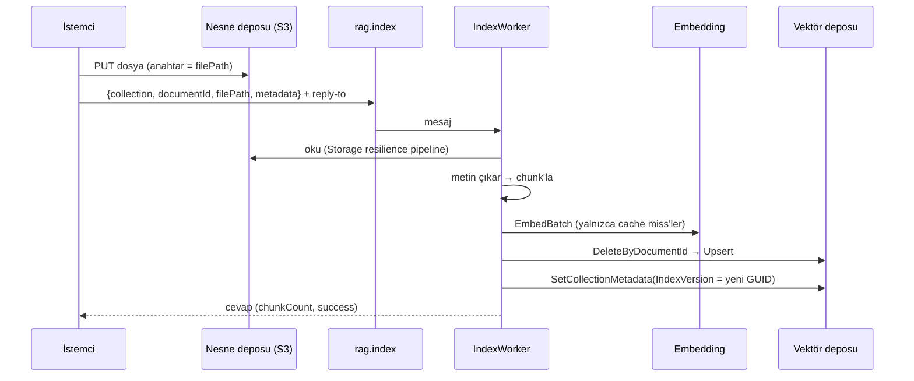

# Bölüm 5 — Doküman Alımı (Ingestion) ve Chunking

**Durum:** ✅ Implemented · 🔵 Planned/ölçülmedi (chunk boyutu/örtüşme deneyleri — Faz 7 yapılmadı; aşağıda "Kanıt")
**Ana dosyalar:** `src/Rag.Core/Services/IndexDocumentService.cs`, `Providers/TextExtraction/*`, `Providers/Chunking/DataIngestionTokenChunker.cs`, `Providers/Storage/S3BlobStorage.cs`
**Doğrulama:** `scripts/e2e.py` bölüm 2–5 (S3'e yükleme → RabbitMQ → IndexWorker → Qdrant)

## 5.1 Nedir?

Ingestion, ham dosyayı arama yapılabilir parçalara çeviren hattır: **depolamadan oku → metin çıkar → chunk'la → embed et → vektör deposuna yaz → indeks sürümünü yükselt.** Hepsi `IndexDocumentService.IndexAsync` içindedir.

## 5.2 Akış

## 5.3 İçeride nasıl çalışır?

### Metin çıkarma

`FileExtensionTextExtractor` uzantıya göre seçer: `.pdf` → `PdfTextExtractor` (PdfPig), `.docx` → `DocxTextExtractor` (OpenXml), diğerleri → `PlainTextExtractor` (UTF-8 metin). Boş metin → `"No text could be extracted"` hatası. **OCR yoktur**: taranmış PDF boş metin verir.

### Chunking (`DataIngestionTokenChunker`)

- `Microsoft.Extensions.DataIngestion.DocumentTokenChunker` ile **token** bazlı: `Chunking:ChunkSize` (varsayılan 1000) ve `ChunkOverlap` (200). Doğrulama: `0 ≤ overlap < size`.
- Tokenizer `Rag:EmbeddingModel`'e göre **tiktoken** (`CreateForModel`); model tiktoken'a bilinmiyorsa (Azure dağıtım adı, `hashing-bow-v1`…) `cl100k_base`'e düşer. Bu düzeltme gerçek bir hatadan geldi: bilinmeyen model adı `NotSupportedException` fırlatıyordu.
- Giriş boş satırlara göre paragraflara bölünüp bölümlenir; boş chunk atılır.
- **Kimlik:** `ChunkId = "{documentId}:{index:D6}"` — **kararlı ve konumsaldır**. Aynı doküman aynı kimlikleri üretir (idempotency, Bölüm 3). Dokümanın başına metin eklenirse sonraki bütün chunk kimlikleri **kayar**; kimlik içerik-hash'i değil sıra numarasıdır. Kaynak atfı (`documentId` + `chunkId`) bu yüzden sürüm içinde güvenilirdir, sürümler arasında chunk bazında karşılaştırılamaz.
- Metadata her chunk'a kopyalanır (filtre ve atıf için).

### Yeniden indexleme ve cache geçersizleştirme

`DeleteByDocumentId` + `Upsert` + yeni `IndexVersion` (GUID). Sorgu cache anahtarı `IndexVersion`'ı içerir (Bölüm 8): bir doküman değişince **eski sonuçlar bir daha sunulmaz**. E2E: dokümanı değiştirip aynı koleksiyonda arama yapınca yeni içerik döndü ve eski içerik dönmedi.

### Kaynak atfı (source attribution)

Her sonuç `documentId`, `chunkId`, `text`, `score`, `metadata` taşır; hybrid/rerank açıkken `sources[]` (`dense`/`lexical`/`rerank`, sıra, orijinal skor) eklenir. Yani bir cevabın hangi dokümandan ve hangi parçadan geldiği ve **hangi aşamanın** onu getirdiği izlenebilir.

## 5.4 Chunk boyutu — ne biliyoruz, ne bilmiyoruz?

- 1000/200 token **varsayılandır**; **bu repoda ölçümle seçilmedi**. Faz 7 (chunking deneyleri) kapsam dışı bırakıldı ve V1 için gerekli görülmedi.
- Ölçtüğümüz tek şey: pilot insan-etiketleme korpusunda **250/40** seçildi, çünkü 1000/200 ile 12 dokümanlık korpus ~36 chunk'a iner ve top-20 korpusun yarısını kaplar (`datasets/human-pilot-v1`). Bu bir **değerlendirme mühendisliği** kararıdır, üretim önerisi değildir.
- Genel trade-off: büyük chunk → bağlam zengin ama konu karışık, embedding bulanık; küçük chunk → odaklı ama bağlam kopuk, daha çok vektör ve maliyet.

## 5.5 Ne ters gidebilir?

- **Aşırı büyük dosya:** tüm metin bellekte; akışlı işleme yok. Boyut limiti uygulanmıyor.
- **Yarım indexleme:** `Delete` ile `Upsert` arasında çökme dokümanı geçici kaldırır (redelivery düzeltir; Bölüm 3 madde 4).
- **Kimlik kayması** (yukarıda).
- **Tablo/kod ağırlıklı doküman:** token bazlı bölme tabloyu ortadan kesebilir; yapı-farkında chunking yok.
- **Gizlilik:** embedding sağlayıcısı OpenAI ise **chunk metni üçüncü tarafa gider**. Hassas içerik için `Hashing` (yalnızca test) veya yerel model gerekir; politika: `docs/eval/send-safety-policy.md`.

## 5.6 Mülakatta nasıl anlatırım?

> "İndexleme idempotent: kimlik deterministik, yazmadan önce dokümanın eski chunk'larını silerim, sonunda koleksiyon sürümünü değiştiririm; cache anahtarı sürümü içerdiği için eski sonuç sunulmaz. Chunk boyutunu ölçmedim; varsayılan 1000/200 ve bunun deneysel doğrulaması yapılmadı — bunu dürüstçe bilinen boşluk olarak kaydettim."
