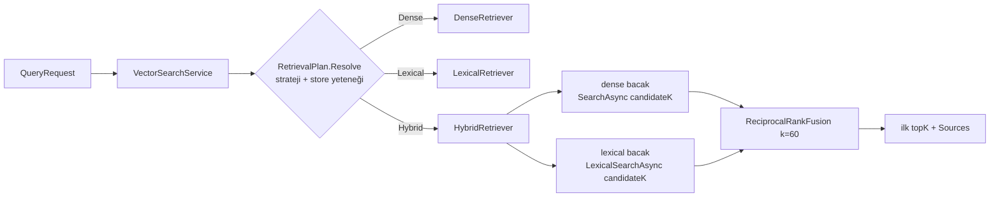

# Bölüm 6 — İleri Seviye Retrieval

**Durum (bölüm bazında):**

| Konu | Durum |
|---|---|
| Dense (semantic) retrieval | ✅ Implemented |
| Lexical retrieval, BM25 tf ağırlıklı sparse vector (Qdrant) | ✅ Implemented (Faz 4) |
| Hybrid retrieval + RRF + source attribution + provider fallback | ✅ Implemented (Faz 4), 🧪 **varsayılan kapalı** — gerçek embedding ile ölçüldü, **dense'ten iyi değil** (§6.8) |
| PgVector'da lexical/hybrid | ❌ Yok → hybrid, dense'e düşer (uyarıyla) |
| Qdrant server-side fusion (Query API `Fusion.Rrf`) | 📖 Değerlendirildi, kullanılmıyor (§6.6) |
| Cross-encoder reranking | 🔵 Planned (Faz 5) |
| Query rewriting / multi-query | 🔵 Planned (Faz 6) |
| HyDE | 📖 Theory — yalnızca evaluation gerekçelendirirse |
| Parent-child retrieval | 🔵 Planned (Faz 7, chunking deneyleri) |

**Kod:** `src/Rag.Core/Retrieval/` (`ResultFusion.cs`, `Retrievers.cs`, `RetrievalPlan.cs`, `RetrievalCapabilities.cs`, `SparseTextEncoder.cs`), `src/Rag.Core/Providers/VectorStores/QdrantVectorStore.cs`, `src/Rag.Core/Services/VectorSearchService.cs`
**Testler:** `ReciprocalRankFusionTests` (14), `HybridRetrieverTests` (9), `HybridSearchServiceTests` (14 test case), `SparseTextEncoderTests` (9), `Bm25IndexTests` (6), `QdrantLexicalSearchTests` (7, gerçek Qdrant)
**Ölçüm:** `docs/eval/phase4-hybrid-comparison.md`

## 6.1 Neden tek bir dense arama yetmez?

Dense retrieval (Bölüm 4) anlam benzerliğini yakalar: "mesajlar sürekli hata veriyorsa ne olur" sorusu, "poison message" geçen dokümanı bulabilir. Ama **nadir ve tam eşleşme** gerektiren sorgularda zayıf kalabilir: hata kodları (`E1042`), identifier'lar (`x-dead-letter-exchange`), ürün adları. Embedding bu token'ı "ortalama bir anlam"a gömer; tam-token eşleşmesinin keskinliği kaybolur.

Lexical retrieval (BM25) tersidir: tam token'a çok duyarlı, eş anlamlıya kördür. İkisinin hata profilleri farklı olduğu için birleştirmek (hybrid) mantıklıdır. Fakat **"mantıklı" bir kanıt değildir**: bu repoda gerçek embedding ile yapılan ölçümde hybrid dense'i geçmedi, bu yüzden varsayılan kapalıdır (§6.8).

## 6.2 BM25 — içeride nasıl çalışır?

Bir doküman `D`, sorgu terimleri `q₁…qₙ` için:

```
score(D,Q) = Σ  IDF(qᵢ) · tf·(k1+1) / ( tf + k1·(1 − b + b·|D|/avgdl) )
IDF(t) = ln(1 + (N − n_t + 0.5) / (n_t + 0.5))     (Lucene varyantı; hep ≥ 0)
```

- **IDF**: terim ne kadar nadirse (`n_t` küçükse) o kadar değerli. "the" her dokümanda → IDF ≈ 0.
- **tf doygunluğu (`k1`)**: bir terimin 4 kez geçmesi, 1 kez geçmesinin 4 katı skor vermez. `k1=1.2` → eğri hızla doygunlaşır.
- **Uzunluk normalizasyonu (`b`)**: uzun doküman doğal olarak daha çok terim içerir; `b=0.75` ile cezalandırılır.

**Elle çözülmüş örnek** (`Bm25IndexTests`): d1="apple banana", d2="banana cherry", d3="cherry date". Sorgu `apple`: N=3, n=1 → IDF = ln(1 + 2.5/1.5) = **0.9808**. d1: tf=1, |D|=avgdl=2 → tf bileşeni = 1·2.2/(1+1.2) = 1 → skor 0.9808. Sorgu `banana`: n=2 → IDF = ln(1 + 1.5/2.5) = **0.4700** (daha yaygın → daha düşük). Test bu değerleri 1e-12 toleransla doğrular.

## 6.3 Sparse vector olarak BM25 (Qdrant yolu)

Qdrant'ta lexical arama, **sparse vector**'le yapılır: çoğu boyutu 0 olan, yalnızca `(indeks, değer)` çiftlerini saklayan vektör.

`SparseTextEncoder` (`src/Rag.Core/Retrieval/SparseTextEncoder.cs`):

1. `LexicalTokenizer`: küçük harf, harf/rakam dizileri, tek karakterli token'lar atılır (Unicode destekli: `çalışan`, `işçi`).
2. Her token → **FNV-1a 32-bit hash** = sparse boyut indeksi. Kelime dağarcığı (vocabulary) tutmak gerekmez; indeksleyici ve sorgulayıcı bağımsız aynı indeksi üretir. Hash testle **sabitlenmiştir** (`apple → 0x10bc2abf`): değişirse tüm mevcut indeksler sessizce bozulurdu.
3. **Doküman tarafı**: BM25'in tf bileşeni (`tf·(k1+1)/(tf + k1·(1−b+b·dl/avgdl))`).
4. **Sorgu tarafı**: her farklı terim için 1.0.
5. **IDF'i Qdrant uygular** (`Modifier.Idf` koleksiyon tanımında). Dot product = Σ IDF·(sorgu 1)·(doküman tf bileşeni) = BM25 skoru.

> ⚠️ **Yaklaşıklık:** `avgdl` yazma anında bilinemez (akışlı indeksleme). Sabit `AssumedAverageLength = 200` varsayılır → uzunluk normalizasyonu **yaklaşıktır**. Evaluation gösterirse ayarlanacak.

**Hash çakışması:** 2³² boyutta, makul kelime dağarcıklarında ihmal edilebilir; çakışırsa değerler toplanır (`SparseTextEncoder.Count`).

### Koleksiyon şeması ve eski koleksiyonlar (gerçek bir keşif)

Yeni koleksiyon: isimsiz dense vector (varsayılan, mevcut sorgular aynen çalışır) **+** isimli `text` sparse vector. Gerçek Qdrant'ta doğrulandı: aynı noktada ikisi birlikte yaşar, dense arama etkilenmez.

**Kritik bulgu:** Bu Qdrant sürümünde mevcut bir koleksiyona sonradan sparse vector **eklenemez** (`UpdateCollection` → `Wrong input: Not existing vector name`). İlk tahminim "güncelleyip eklerim" idi; test bunu çürüttü. Sonuç:

| Durum | Davranış |
|---|---|
| Yeni koleksiyon | dense + sparse; lexical/hybrid çalışır |
| **Eski (dense-only) koleksiyon** | İndeksleme **çalışmaya devam eder** (sadece dense yazılır; mevcut kurulumlar kırılmaz). Lexical arama `LexicalSearchUnavailableException` fırlatır. Hybrid bu bacağı kaybeder → dense'e düşer + uyarı |
| Etkinleştirme | **Yeni koleksiyon oluştur + dokümanları yeniden indeksle** |

Bu, "provider yeteneklerini açıkça modelle" ilkesinin somut örneğidir: yetenek yalnızca *store türü*ne değil *koleksiyona* da bağlıdır.

## 6.4 Hybrid retrieval — mimari



Tasarım kararları (koda bakarak):

- **`IVectorStore` değişmedi.** Lexical, opsiyonel `ILexicalSearchStore` arayüzüdür. `StoreCapabilities.Of(store)` `Dense | Lexical` bayraklarını verir. Yetenek olmayan store (PgVector) stub yazmaz; iş katmanı "ne yapabilirsin?" diye sorar.
- **`RetrievalPlan.Resolve`** istenen stratejiyi store yeteneğiyle birleştirir: `Hybrid` istendi ama lexical yok → **dense'e düş + `hybrid-unsupported:fell-back-to-dense` uyarısı**; `Lexical` istendi ama yok → açık hata.
- **İki bacak eşzamanlı** çalışır (`Task.WhenAll`), **aynı filtreyle**; metadata filtreleme stratejiden bağımsız tutarlıdır.
- **Bacak izolasyonu:** bir bacak çökerse sorgu diğeriyle devam eder (`hybrid:lexical-leg-failed`); ikisi de çökerse hata. **İptal (cancellation) degradation sayılmaz.**
- **Degrade sonuç cache'lenmez:** lexical bacak düşmüşken üretilen sonucu 5 dakika cache'e yazmak, bacak düzeldiğinde bile kötü sonuç sunardı. Test: `DegradedHybridResults_AreNeverCached`.
- **Cache kimliği:** `StrategyId` = `hybrid:rrf60:cand50:w1/1` (RRF k, aday sayısı, ağırlıklar) fingerprint'e girer. k=60 ile k=10 aynı anahtarı paylaşsaydı yanlış sonuç gelirdi. Test: `CacheEntries_AreNotSharedBetweenFusionParameters`. (Bölüm 8)
- **Lexical stratejide embedding çağrısı atlanır** (maliyet + gecikme tasarrufu).
- **Sözleşme geriye dönük uyumlu:** Dense'te payload bire bir eskisi gibi (`Sources` null, `Warnings` null). Lexical/hybrid'de `Sources` ve `Score` (RRF skoru — **cosine değildir!**) gelir.

## 6.5 Reciprocal Rank Fusion (RRF)

**Problem:** Cosine skoru [−1,1], BM25 skoru [0,∞) — birimleri farklı. Skorları toplamak veya ortalamak anlamsızdır (skor normalizasyonu kırılgandır: dağılım sorguya göre değişir). RRF **yalnızca sıraları** kullanır:

```
RRF(d) = Σ_listeler  w_liste / (k + sıra_liste(d))        sıra 1-tabanlı
```

`k=60` (Cormack ve ark., 2009) listelerin baş tarafının baskınlığını sönümler: 1. sıra 1/61, 2. sıra 1/62 — fark küçük, yani "iki listede de orta sıralarda olan", "tek listede birinci olan"a yaklaşabilir.

**Elle çözülmüş örnek** (testle birebir): A = [a b c], B = [b c d], k=60.

| Chunk | A | B | RRF |
|---|---|---|---|
| a | sıra 1 → 1/61 | — | 0.016393 |
| b | sıra 2 → 1/62 | sıra 1 → 1/61 | **0.032522** |
| c | sıra 3 → 1/63 | sıra 2 → 1/62 | 0.032002 |
| d | — | sıra 3 → 1/63 | 0.015873 |

Sıra: **b, c, a, d**. İki listede de bulunan `b` ve `c`, yalnızca birinde birinci olan `a`'yı geçer — konsensüs ödüllendirilir.

Uygulama garantileri (`ReciprocalRankFusion`):

- **Kimlik = `ChunkId`**; aynı listede tekrar eden chunk **ilk sırada** sayılır.
- **Stabil sıralama:** skor ↓, sonra **en iyi sıra ↑**, sonra ChunkId ordinal. Liste verilme sırasından bağımsız (test: ters sırada aynı sonuç). Eşitlikte *en iyi sıra*nın alfabetik sıradan önce geldiği ayrı testle doğrulanır.
- **Kaynak izleme (attribution):** her sonuçta `Sources = [(dense, sıra 2, 0.5), (lexical, sıra 1, 12.5)]` — hangi retriever'ın ne kadar katkı verdiği gözlemlenebilir.
- **Ağırlıklar** (`DenseWeight`, `LexicalWeight`), `k` yapılandırılabilir; `k ≤ 0`, `topK ≤ 0`, negatif ağırlık reddedilir.
- Metin/metadata, chunk'ı içeren **ilk listeden** alınır.

## 6.6 Karar: Qdrant'ın native hybrid'i değerlendirildi

Qdrant Query API'si `prefetch` + `Fusion.Rrf` ile fusion'u **sunucuda** yapabilir (istemci kütüphanesinde `QueryAsync`, `PrefetchQuery`, `Fusion`, `Rrf` mevcut; doğrulandı).

| Kriter | Server-side fusion | Client-side RRF (seçilen) |
|---|---|---|
| Round-trip | 1 | 2 (paralel) |
| Provider bağımsızlığı | Yalnız Qdrant | Tüm store'lar aynı kod |
| k parametresi / ağırlıklar | Sunucu sürümüne bağlı | Tam kontrol, `k=60`, ağırlıklı |
| Source attribution | Kaybolur | Korunur |
| Offline evaluation ile eşlik | Ayrı kod yolu | **Aynı** `ReciprocalRankFusion` sınıfı ölçülüyor |

**Karar:** Qdrant'ın **sparse vector + IDF** altyapısı lexical bacak için kullanılır (kendi BM25 sunucumuzu yazmak yerine); **fusion istemci tarafında** kalır. Gerekçe: tek fusion implementasyonu = tek test seti = ölçülen şey ile prod'da çalışan şey aynı. Gecikme darboğaz olursa native fusion `RetrievalCapabilities.NativeHybrid` olarak eklenebilir (🔵 backlog).

## 6.7 Ne ters gidebilir?

| Senaryo | Sonuç | Savunma |
|---|---|---|
| Eski koleksiyonda hybrid | Lexical bacak her sorguda hata → uyarı, dense sonuç | `LexicalSearchUnavailableException`, uyarı; **maliyet:** her sorguda başarısız RPC (iyileştirme adayı: capability cache) |
| Dense ve lexical filtre semantiği farklı | Bir bacak daha geniş küme döndürür | Aynı `Dictionary` filtre iki bacağa aynen geçilir; test: `Filters_AreAppliedIdenticallyByEveryStrategy` |
| `candidateK < topK` | Füzyon topK'yı dolduramaz | `max(CandidateK, TopK)` |
| Hash/tokenizer değişimi | Mevcut sparse indeks sessizce uyumsuz | Hash testle sabit; tokenizer değişirse reindex + index version |
| Çok kısa/sembolik sorgu (`?!`) | Lexical boş | Boş vektör → boş sonuç, hata değil |
| Dokümanda hiç indekslenebilir token yok | Sparse vektör boş (Qdrant kabul etmeyebilir) | Nokta yalnız dense vektörle yazılır |
| Prompt injection içeren chunk | Retrieval ürettiğini güvenilir sanma | Bölüm 13 (ayrıca `Sources` denetlenebilirlik sağlar) |

## 6.8 Ölçüm: ne söylüyor, ne söylemiyor

`docs/eval/phase4-hybrid-comparison.md`. İki koşu seti var ve **ikincisi birincisini çürütüyor**; bu bölümün dersi budur.

**1) Sentetik embedder** (bag-of-words, IDF'siz): K=10 document nDCG — dense 0.717, lexical 0.787, hybrid 0.787. "Hybrid ≈ lexical > dense" gibi görünüyordu.

**2) Gerçek embedding** (`text-embedding-3-small`, aynı dataset, aynı vektörler):

| K=10 document | Hit | Recall | MRR | nDCG |
|---|---:|---:|---:|---:|
| **dense** | 1.000 | 0.942 | 0.921 | **0.903** |
| lexical | 0.975 | 0.879 | 0.832 | 0.787 |
| hybrid (RRF k=60, eşit ağırlık) | 1.000 | 0.954 | 0.877 | 0.857 |

K=1'de nDCG: dense **0.832**, hybrid 0.768. Paraphrase kategorisinde K=10 nDCG: dense **0.871**, hybrid 0.767, lexical 0.630.

**Sonuç: bu dataset'te hybrid, dense'i geçmiyor; nDCG ve MRR'da her K'da daha kötü.** İlk (sentetik) sonucun nedeni zayıf bir dense bacaktı: onu "hybrid işe yarıyor" kanıtı olarak sunmak yanıltıcı olurdu. Bu yüzden Faz 4'te hybrid'i varsayılan yapmama kararı doğru çıktı.

*Olası açıklama (hipotez, test edilmedi):* gerçek dense zaten Recall@10 = 0.942 ve keyword nDCG 0.974'te; lexical'in ekleyeceği az. Eşit ağırlıklı RRF ise zayıf lexical sıralamanın paraphrase sorgularında iyi dense sonuçlarını aşağı çekmesine izin veriyor.

**Bu ölçüm neyi kanıtlamaz:** 40 puanlanan sorgu, tek anotatör, 35 kısa doküman — ve doküman metinleri çoğunlukla düzyazı; çok sayıda kod/identifier içeren bir corpus lexical'e daha çok yer açabilir. Tek sorgu ±0.025 oynatır; güven aralığı hesaplanmadı. Lexical ağırlığı **ayarlanmadı**: aynı 40 sorguda ayar yapmak overfitting olur, önce held-out ayrımı gerekir.

**3) Tuning + held-out (ölçüm disiplini, Bölüm 7 §7.7c):** lexical ağırlığı, RRF k ve aday sayısı 36 konfigürasyonluk bir gridde **yalnız tune setinde** arandı. Seçilen (0.5 / k=30 / 20 aday) tune setinde dense'i sadece 0.006 geçti; **held-out'ta nDCG@10 dense 0.861, hybrid 0.785 (fark −0.076, %95 aralık [−0.155, −0.010])**. Önceden yazılmış kabul kuralının üç koşulu da başarısız: hybrid kabul edilmedi. Yani ayarlama da hybrid'i kurtarmadı.

**Ders (mülakat için):** Sentetik/yetersiz bir bileşenle alınan olumlu sonuç, gerçek bileşenle tersine dönebilir. Bu yüzden "kapalı varsayılan + ölçüm kapısı" yaklaşımı pahalı bir hatayı önledi.

## 6.9 Planlanan: reranking, query rewriting, HyDE, parent-child (henüz uygulanmadı)

Bu alt bölümler **kavramsaldır**; repoda kod yoktur. Faz 5–7'de uygulandıkça "Implemented"a geçecek.

- **Cross-encoder reranking (🔵 Faz 5):** Bi-encoder (embedding) sorgu ve dokümanı *ayrı* kodlar → hızlı, ölçeklenebilir ama kaba. Cross-encoder ikisini *birlikte* okur → çok daha doğru, ama N doküman için N model çağrısı. Bu yüzden iki aşama: ucuz aday üretimi (CandidateK ≈ 50) → pahalı yeniden sıralama → TopK. Karar kriteri: nDCG/MRR kazancı vs. eklenen p95 gecikme ve maliyet; başarısızlıkta rerank'siz sıraya düşme.
- **Query rewriting / multi-query (🔵 Faz 6):** LLM ile sorguyu yeniden yazma/genişletme. Riskler: niyet kayması (drift), ekstra LLM maliyeti/gecikmesi. Koruma: varlık/sayı değişirse orijinal sorguya geri dön; gereksiz LLM çağrısından kaçın.
- **HyDE (📖 Theory):** LLM'den varsayımsal cevap yazdırıp onu embed etmek. Kısa sorgularda yardımcı olabilir; halüsinasyonla yanlış yöne çekebilir. Yalnızca evaluation gerekçelendirirse.
- **Parent-child (🔵 Faz 7):** Küçük "child" chunk'larla eşleş, daha büyük "parent" bölümü döndür. Kesin eşleşme + geniş bağlam; stabil parent ID gerektirir.

## 6.10 Alternatifler (hybrid için)

| Yaklaşım | Artı | Eksi |
|---|---|---|
| Sadece dense | Basit | Tam-token eşleşmede zayıf |
| Sadece BM25 | Keyword'de güçlü, ucuz | Paraphrase'e kör |
| **Hybrid (RRF)** | İki sinyal, normalizasyon gerektirmez | İki sorgu, daha fazla altyapı |
| Hybrid (skor birleştirme/DBSF) | Skor bilgisini korur | Normalizasyon kırılgan |
| Daha büyük topK + LLM'in seçmesi | Basit | Token maliyeti, "lost in the middle" |
| Reranker | En yüksek hassasiyet | Gecikme + maliyet |

## 6.11 Mülakatta nasıl anlatırım?

> "Dense retrieval anlamı yakalar ama identifier ve hata kodu gibi tam eşleşmelerde zayıf; BM25 tersi. İkisini birleştirdim ama skorları toplamadım, çünkü cosine ve BM25 farklı ölçeklerde; Reciprocal Rank Fusion yalnızca sıraları kullanıyor, k=60 ile baş sıraların baskınlığını sönümlüyor. Lexical bacak için kendi BM25'imi yazmak yerine Qdrant'ın sparse vector + IDF modifier'ını kullandım, fusion'u ise istemci tarafında bıraktım ki tek implementasyon ve tek test seti olsun, kaynak atfı korunsun. Yetenekleri açık modelledim: PgVector lexical desteklemiyor, hybrid dense'e uyarıyla düşüyor. Bir bacak düşerse sorgu diğeriyle devam ediyor ve degrade sonuç cache'lenmiyor. En önemlisi: hybrid'i ölçtüm. Sentetik embedder ile iyi görünüyordu, ama gerçek `text-embedding-3-small` ile dense'ten daha kötü çıktı (nDCG@10 0.857'ye karşı 0.903); o yüzden kapalı bıraktım ve lexical ağırlığını aynı 40 sorguda ayarlamadım, çünkü bu overfitting olurdu."

## Alıştırmalar

1. RRF örneğinde `k=1` ile sırayı yeniden hesapla. Baş sıraların etkisi nasıl değişir? `k→∞` iken ne olur?
2. `DenseWeight=1, LexicalWeight=3` ile `a` (yalnız dense 1.) ve `b` (yalnız lexical 1.) arasındaki sıra ne olur? Testini yaz.
3. Eski koleksiyonda hybrid her sorguda başarısız bir RPC yapıyor. Bunu "koleksiyon başına capability cache" ile nasıl düzeltirsin? Cache ne zaman geçersizleşmeli? (İpucu: Bölüm 8, index version.)
4. `AssumedAverageLength` neden bir varsayım? Evaluation ile nasıl ayarlarsın (hangi parametre taraması, hangi metrik)?
5. PgVector için lexical bacak tasarla: `tsvector` + `ts_rank_cd` BM25 midir? Farkı açıkla.
